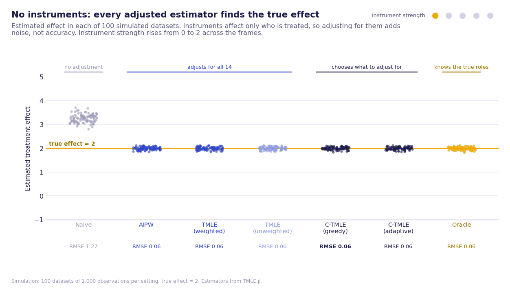
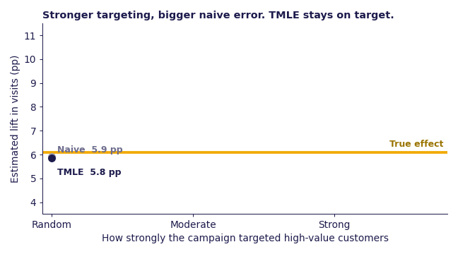
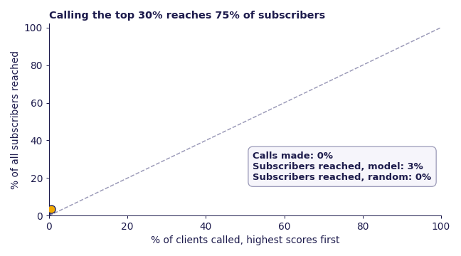
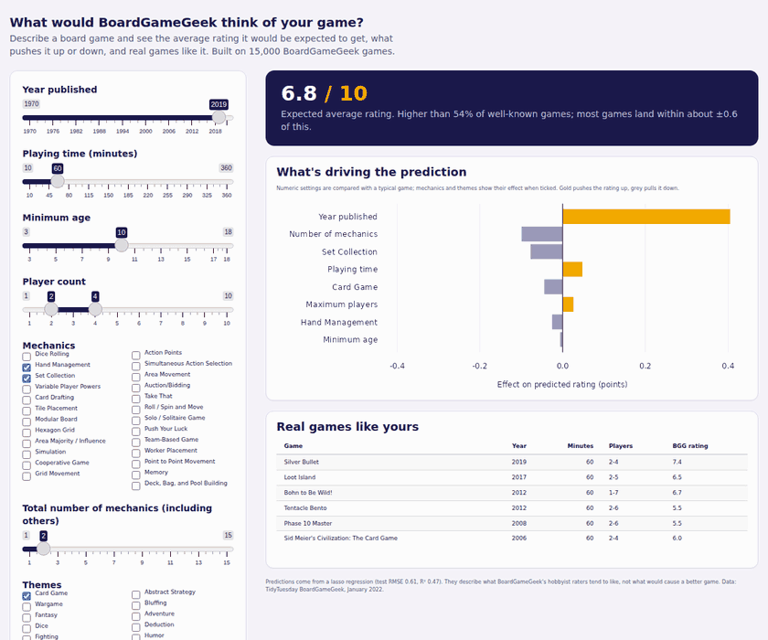

# Hi, I'm Asantewaa 👋

I'm a **PhD researcher in Statistics** at the University of Edinburgh, working at the intersection of causal inference, machine learning, and large-scale health data. My research focuses on estimating causal effects from observational healthcare and genomic data, specifically with the goal of applying Collaborative Targeted Maximum Likelihood Estimation (C-TMLE) to UK Biobank and on other biomedical databases.

Before my PhD, I spent 4+ years as a data scientist and analyst, delivering data-driven insights for multinational clients including Microsoft, Unilever, P&G, and Betway. I love bridging the gap between rigorous statistical methodology and real-world impact.

---

## 🔬 What I Work On

- **Causal Inference** - C-TMLE, TMLE, IPW, propensity score methods
- **Statistical Modelling** - high-dimensional regression, semiparametric efficiency theory
- **Machine Learning** - LASSO/elastic net, SuperLearner, ensemble methods
- **Data Visualisation** - ggplot2, Tableau, Power BI, Looker
- **Health & Genomic Data** - Dataloch, DecodeME, UK Biobank, observational study design, missing data

---

## 🛠️ Tech Stack

---

## 🏥 Health and Clinical Data

### [Has the deprivation gap in hospital admissions changed since COVID?](https://github.com/Asantewaah/scotland-admissions-inequalities)

People in Scotland's most deprived areas have about **twice as many emergency hospital admissions** as those in the least deprived. Using Public Health Scotland open data for every NHS board, I measure the gap four ways (rate ratio, rate difference, slope and relative indexes of inequality) and use an interrupted time series to test whether the pandemic shifted it. The gap narrowed from **2.13 to 2.01 times** between 2019/20 and 2024/25, at about its pre-pandemic pace, and is now widest in Lothian and Greater Glasgow. A [**live Shiny dashboard**](https://asantewaah.github.io/scotland-admissions-inequalities/) lets you explore any board.

`R` `Health inequalities` `Interrupted time series` `Public Health Scotland` `Shiny`

---

## 📂 Causal Inference Methods

### 🧬 [Causal Inference in High-Dimensional Observational Data](https://github.com/Asantewaah/causal-inference-simulation)

A comparative simulation study benchmarking TMLE and C-TMLE estimators across low- and high-dimensional settings. With 100 correlated covariates, every C-TMLE variant beat standard TMLE on accuracy (greedy C-TMLE **RMSE 0.042 vs 0.109**), but only one kept near-95% confidence interval coverage, so the study also shows where influence-function inference falls short. Built in R with `glmnet` and influence function-based inference. Motivated by my PhD research on causal effect estimation in genomic data.

`R` `TMLE` `C-TMLE` `glmnet` `Causal Inference` `Simulation`

### ⚖️ [More adjustment is not always better: C-TMLE in Julia](https://github.com/Asantewaah/ctmle-breakdown)

Adjusting for every available covariate sounds safe, but covariates that only drive treatment make estimates unstable. In a 500-dataset simulation run on the Eddie HPC cluster, **C-TMLE was 2.5× more accurate than AIPW** with strong instruments and nearly matched an oracle that knew the true confounders, without being told which covariates matter. Built with TMLE.jl, with an interactive Pluto notebook.

`Julia` `TMLE.jl` `C-TMLE` `Simulation` `HPC`

### 🔧 [TMLE.jl - Open Source Contributor](https://github.com/TARGENE/TMLE.jl)

Actively extending `TMLE.jl` - a Julia package for Targeted Minimum Loss-Based Estimation published in the *Journal of Open Source Software* (2025), by integrating **Collaborative TMLE (C-TMLE) estimators** into the package. I implemented a Lasso C-TMLE strategy, a GLMNet model wrapper, tests and a bootstrap simulation study, currently on a development branch. Developed in collaboration with the TARGENE research group at the University of Edinburgh.

`Julia` `TMLE` `C-TMLE` `Causal Inference` `Open Source` `Research Software`

---

## 📊 Business and Consumer Analytics

### [Did the email campaign actually work?](https://github.com/Asantewaah/email-campaign-causal-impact)

When a campaign targets its best customers, a naive comparison overstated the email's impact by **about 60%**. Checked against a real randomised experiment on 64,000 customers, AIPW and TMLE (implemented from scratch) recover the true effect with honest 95% intervals. A causal forest trained only on the targeted data then finds *who* responds, and its ranking holds up against the experiment.

`Python` `TMLE` `AIPW` `Causal forest` `Marketing`

### [Who should the bank call?](https://github.com/Asantewaah/marketing-financial-analytics)

On 41,188 real bank calls, targeting the top-scored 30% of clients wins **2.5× the subscriptions** of random calling on the same budget, keeping 93% of the profit with 70% fewer calls. Trained on earlier calls and tested on later ones, the model still reaches a ROC-AUC of 0.74.

`Python` `XGBoost` `SHAP` `Out-of-time validation` `Finance`

### [What makes a board game highly rated?](https://github.com/Asantewaah/boardgame-ratings)

An R analysis of 15,249 BoardGameGeek games, with a [**live Shiny app**](https://asantewaah.github.io/boardgame-ratings/) that runs in the browser via WebAssembly. Release year is the strongest predictor, and many popular mechanics lose their advantage once year and length are held constant.

`R` `tidyverse` `glmnet` `ranger` `Shiny`

---

## 📚 Currently

- 🎓 PhD in Statistics - University of Edinburgh *(causal inference, missing data, UK Biobank)*
- 🔧 Integrating C-TMLE estimators into [`TMLE.jl`](https://github.com/TARGENE/TMLE.jl) *(Lasso C-TMLE implemented and tested on a development branch)*
- 📖 Reading: *What If* by Hernán & Robins *(the causal inference bible)*

---

## 📫 Get In Touch

I'm always happy to connect - whether it's about causal inference, data science, or potential collaborations.

---

*"Data is not just numbers, it's the story of people's lives."*
